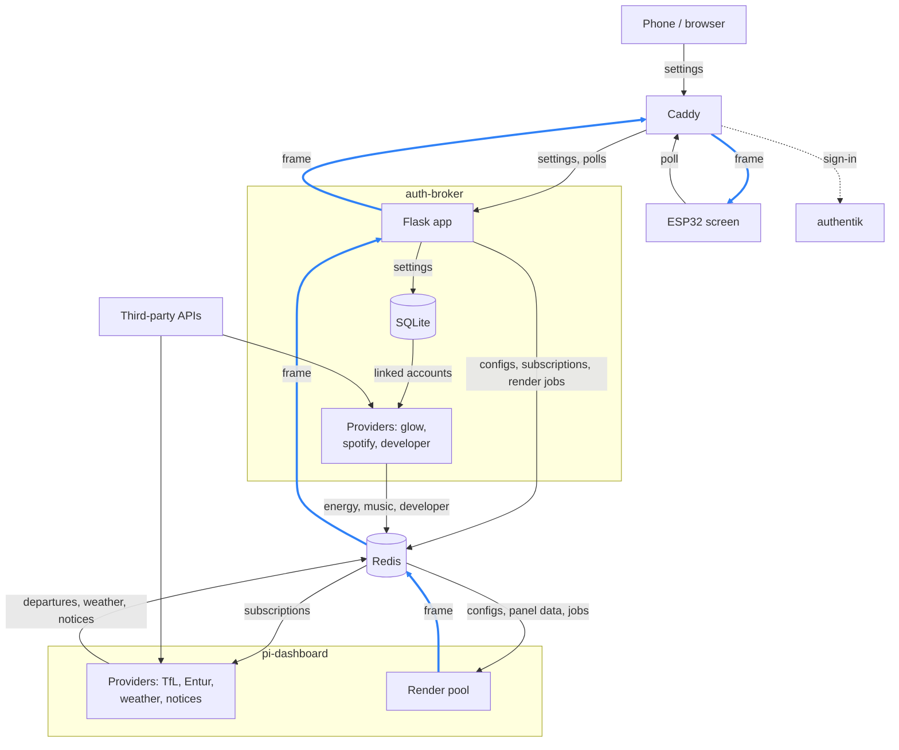
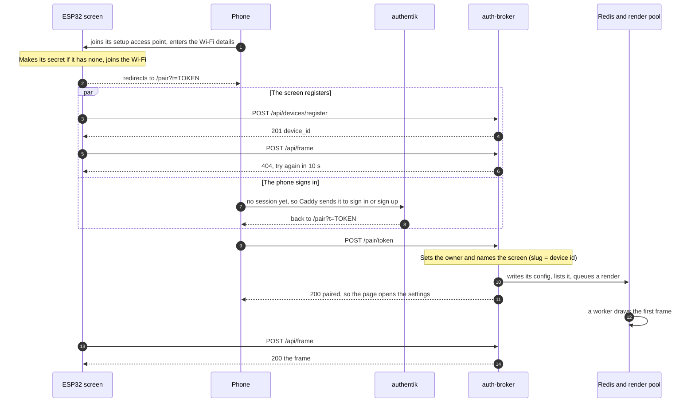
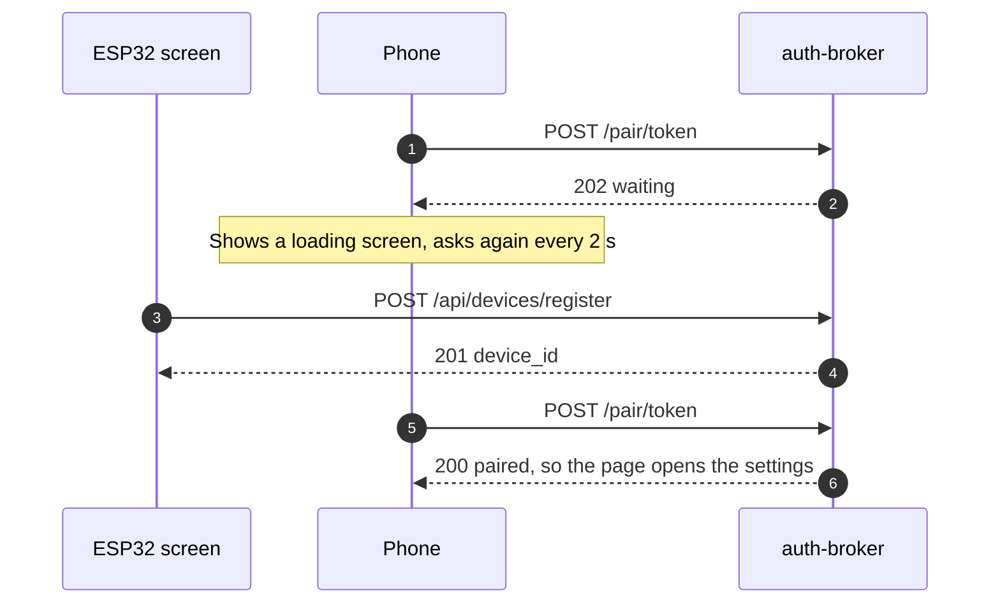
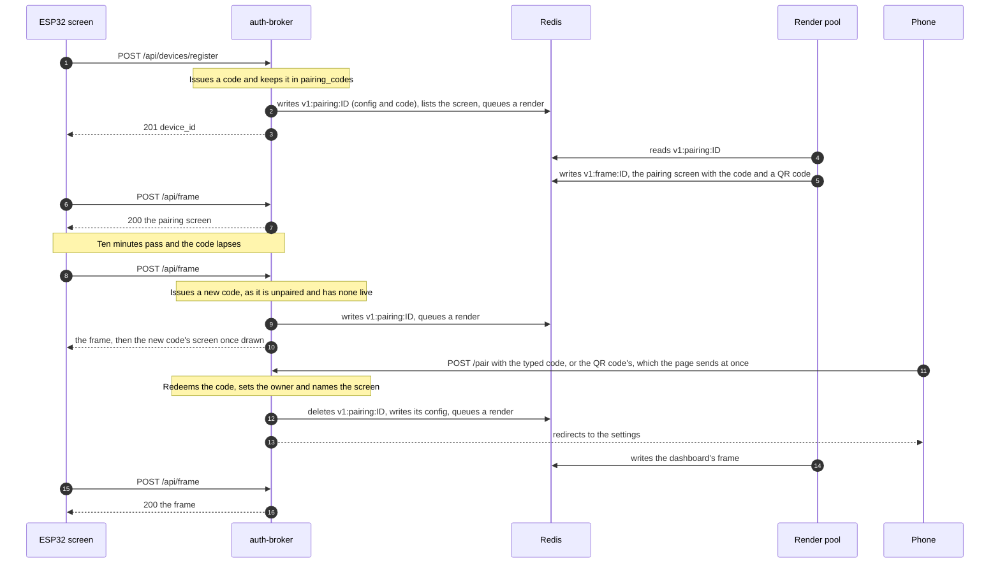
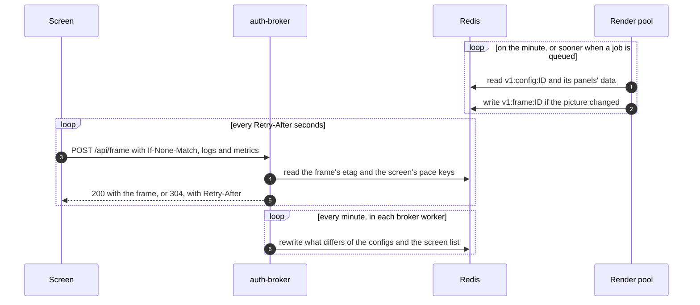
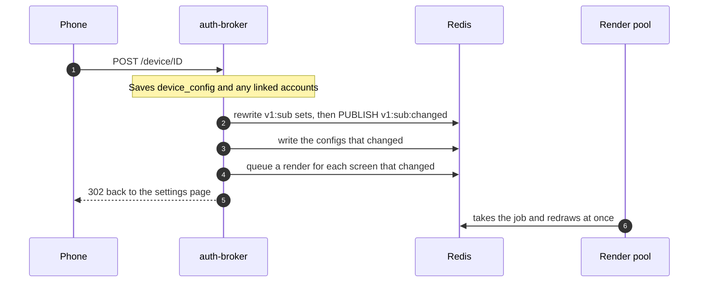

# How the pieces fit together

Who calls whom, which secret is which, and what happens when. The [README](../README.md) says how to run and deploy
it; [the database](database.md) has the tables.

## The parts

| Part | Where | What it does |
|---|---|---|
| **Screen** | [countdown-esp32](https://github.com/nvorkinn/countdown-esp32) | An ESP32 driving a 7.5" 800x480 black-and-white e-paper panel. Registers with the broker, then polls it for finished frames. It draws nothing itself. |
| **Render pool** | [pi-dashboard](https://github.com/nvorkinn/pi-dashboard), on the same host | Workers and a ticker. Draws every screen in `v1:render:screens` from its config and panel data in Redis, and writes the frame back to Redis. It never calls the broker. |
| **pi-dashboard's providers** | pi-dashboard, on the same host | Fetch TfL, Entur, weather and notice data for the stops and places in the broker's subscriptions, into Redis. |
| **auth-broker** | this repository | Device identities, pairing, settings, linked accounts, the configs and subscriptions in Redis, and serving frames. State is one SQLite file. |
| **The broker's providers** | this repository, the broker's image | glow (energy), spotify (Spotify and Apple Music) and developer (GitHub). They need credentials only the broker holds, so they run here. |
| **Caddy** | this repository | TLS, routing, and the authentik sign-in gate for browser pages. |
| **authentik** | this repository (`terraform/`) | Sign-in, sign-up, passkeys and Google login. Its embedded outpost answers Caddy's forward auth. |
| **Redis** | this repository | The store between the broker, the providers and the render pool. A cache: nothing on disk. |
| **Fluent Bit, VictoriaLogs, VictoriaMetrics** | this repository | Logs and metrics from the containers, the render pool and the screens. |
| **countdown-api** | [countdown-api](https://github.com/nvorkinn/countdown-api), the `vendor/countdown-api` submodule | The store contract: every Redis key shared with pi-dashboard, the models of their values, and the fixtures both sides test against. |

## Who talks to whom

Arrows point the way the data goes. The blue path is a frame on its way to the screen: the render pool writes it to
Redis, the broker reads it from there, and serves it through Caddy to the ESP32 when the screen polls.

Everything runs on one host, with host networking, so services reach each other on `127.0.0.1` (authentik is the
exception: it publishes only `127.0.0.1:9000`).

Caddy routes by path. The screen's paths (`/api/frame`, `/api/devices/*`), the status endpoint (`/api/status/*`) and
the public `/about` page go straight to the broker, which checks the bearer secret itself. Every other path is a
browser page: Caddy asks authentik's outpost first, then passes `X-Authentik-Uid` and `X-Authentik-Username` to the
broker. Caddy strips those headers from every incoming request, and the broker listens only on loopback, which is what
makes it safe for the broker to trust them. The broker has no user table: the uid is stored as a device's `owner`.

## Secrets

| Secret | Made by | Stored | Notes |
|---|---|---|---|
| **Screen secret** | the screen, on first boot | the screen's flash; the broker keeps its SHA-256 | `Authorization: Bearer` on every screen call. Ends when the screen is unlinked or forgotten, or its flash is erased. |
| **Pairing token** | both sides: `sha256("pairing:" + sha256hex(secret))` | `devices.pairing_token` | In the URL the phone is sent to after Wi-Fi setup. Safe to show, as it's one-way. |
| **Pairing code** | `flask devices code` / `unpair` | `pairing_codes`, and `v1:pairing:<device id>` for the pool to draw | 6 characters, 10 minutes, one use. |
| **Spotify tokens** | Spotify OAuth, `/auth/spotify/callback` | `spotify_tokens`, plaintext | Refreshed by the music provider. |
| **Apple Music user token** | MusicKit JS on the settings page | `apple_music_tokens`, encrypted | Lasts about six months, can't be refreshed: cleared when Apple refuses it. |
| **Glowmarkt password** | the owner, on the settings page | `glowmarkt_credentials`, encrypted | Never leaves the broker's image: the glow provider signs in with it. |
| **GitHub token** | the owner, on the settings page | `github_tokens`, encrypted | A read-only fine-grained PAT, used only by the developer provider. |
| **`CREDENTIAL_ENCRYPTION_KEY`** | operator | `secrets/broker.env` | The Fernet key for the encrypted columns. Changing it makes them unreadable. |
| **App keys** | operator | `secrets/broker.env` | Spotify client id and secret, the MusicKit key (signs Apple developer tokens), `TFL_APP_KEY` (only for the settings page's stop search). |
| **`FLASK_SECRET_KEY`** | operator | `secrets/broker.env` | Signs the session cookie, which holds only the Spotify OAuth state (and which screen it's for) and the GitHub dashboard's CSRF token. |
| **`STATUS_TOKEN`** | operator | `secrets/broker.env` | Bearer for `GET /api/status/devices`. |
| **`GITHUB_DASHBOARD_TOKEN`** | operator | `secrets/broker.env` | The `/github` dashboard's PAT. |
| **`REDIS_PASSWORD`** | operator | `secrets/redis.env` | Used by everything that talks to Redis, including pi-dashboard. |
| **`LOGS_INGEST_TOKEN`** | operator | `secrets/caddy.env` | Bearer for the ingest paths on `logs.` and `metrics.`. The broker forwards on loopback without it. |

No credential is ever written to Redis: configs carry only flags like `glowmarkt.enabled`, and the providers write only
the data they fetched. The pairing code is the exception, in `v1:pairing:<device id>` for its ten minutes.

## Setting up a screen

Once the owner has given the screen their Wi-Fi details, two things happen at the same time: the screen registers
with the broker, and the phone is sent to the pairing page, signing in with authentik on the way if it has to.

### Usually: the screen has registered by the time the phone gets there

### Rarely: the phone gets there first

From there it goes on as above. If the screen hasn't registered after 90 seconds, the page stops waiting and asks for
the pairing code instead.

### The owner walks away before pairing

If the owner isn't sent to `/pair` by the Wi-Fi setup, or doesn't finish, the screen shows a pairing code itself. The
broker issues one when the screen registers, and the render pool draws it, with a QR code to `/pair?code=…`, as the
screen's frame. A code lapses after ten minutes. While the screen is unpaired, each of its polls issues a new code if
none is live, so it always has one to show.

- A code works once, and a wrong one counts against the phone's IP address: too many in a row lock it out for a while.
- A code also hands a screen that already has an owner to a new one.
- A screen nobody pairs within 24 hours is forgotten, and registers again on its next call.

The screen registers on every boot and after a 401, not on every poll, but its polls keep the code live. It shows only
frames from the broker: the pairing screen is one of them.

## Steady state

- The broker reads the frame's 48 KB only for a `200`. It keeps no copy: with no record (Redis restarted, say) the
  screen gets a `404` and keeps its picture until the pool draws it again, within the minute.
- The screen's logs and metrics are forwarded to VictoriaLogs and VictoriaMetrics in the background.
- `devices.last_seen_at` and `display_last_seen_at` move with the screen's calls, at most once a minute.

## Saving settings

The providers wake on `v1:sub:changed` and fetch anything new straight away. If Redis can't be written, the save
still succeeds: the minute's rewrite catches up on the configs, and the subscriptions are written again on the next
save, broker restart or `flask config publish`.

## Quiet screens and deletion

- A screen not seen for 24 hours is left out of `v1:render:screens`, so nothing is drawn for a screen that's off. It's
  listed again (with a render queued) within a minute of its next poll.
- `flask devices forget` deletes the device and everything hanging off it, and its keys in Redis. The screen's next
  poll is a `401`, so it registers again as a new device with the same pairing token; its owner pairs it again.
- `flask devices unpair` clears the owner and issues a new code, which the pool draws. `--config` also resets the
  settings and linked accounts and deletes the frame.

## Pace

How long a screen sleeps after each poll is worked out in one place, `broker/services/pace.py`, from the broker's
clock (the ESP32 has none), and sent as `Retry-After` on every frame answer.

- Renders land on the minute, and the screen polls twice as often, 3 s after each half-minute (about :03 and :33), so
  an out-of-cycle render shows within about 30 seconds.
- A provider whose data is bursty writes a pace hint, `v1:pace:<source>:<id>`, with a short TTL. The developer
  provider writes 20 s while a release is running, and the music provider while Spotify plays (it then fetches the
  track's position, `/me/player/currently-playing`, every 20 s and queues a render after each write; the queue and
  the rest stay a minute apart). The broker reads the hints for the screen's panels on each poll;
  the shortest live one (at least 20 s) replaces the minute, so the screen polls every 10 s. When the key lapses, the
  screen goes back to the half-minute.
- A slot under 5 s away is skipped for the next, and every answer starts from the clock again, so network delay never
  adds up.
