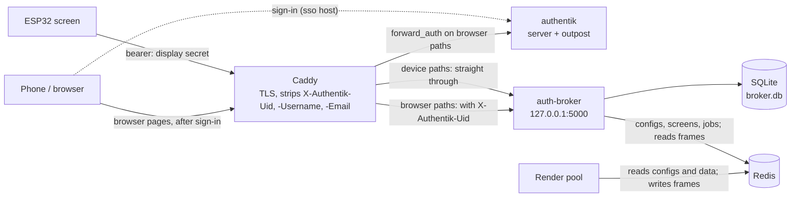
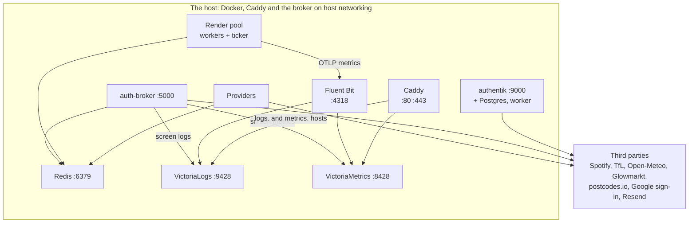
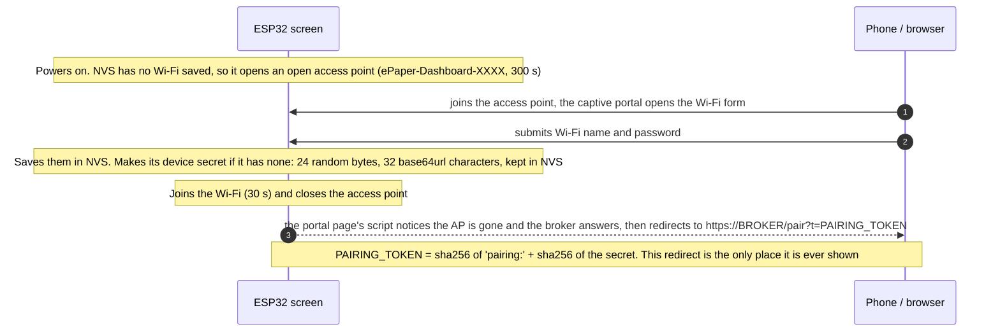
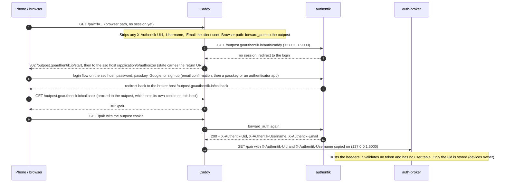
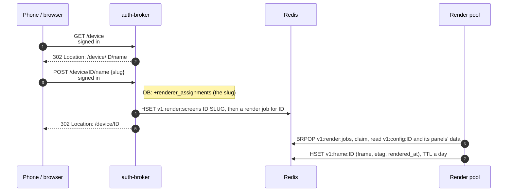
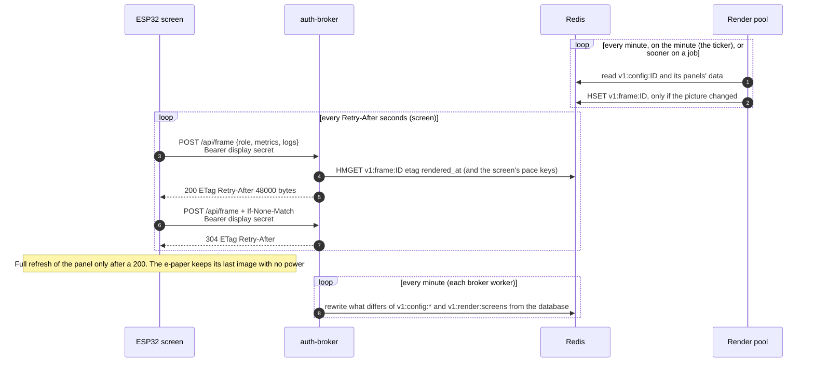
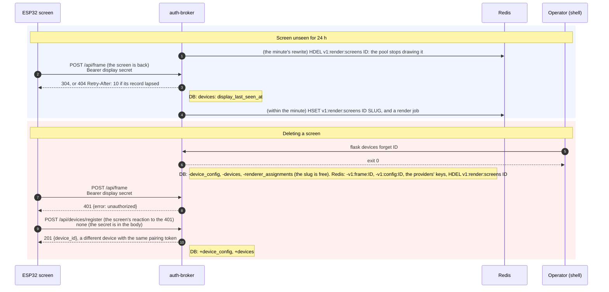
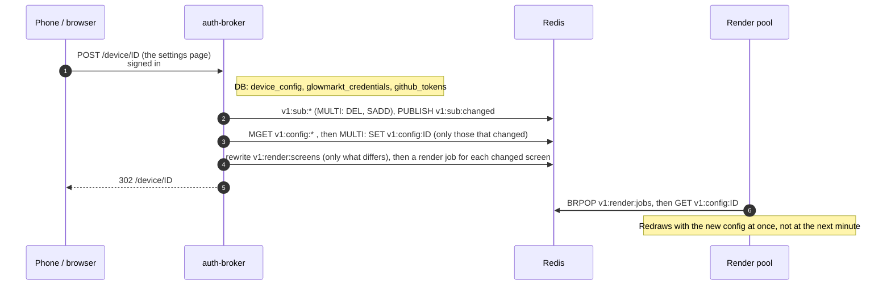

# How the pieces fit together

Who calls whom, which token exists when, and what each call changes. The README says how to run and deploy the broker;
this page is the map. [The database](database.md) has the tables.

- [The parts](#the-parts)
- [Who calls the broker, and how](#who-calls-the-broker-and-how)
- [Tokens and secrets: what exists when](#tokens-and-secrets-what-exists-when)
- [What happens when](#what-happens-when): [first boot](#1-first-boot-the-esp32), [signing in](#2-signing-in), [pairing](#3-pairing), [naming](#4-naming), [steady state](#5-steady-state), [going quiet and deletion](#6-going-quiet-and-deletion)
- [Responses worth knowing](#responses-worth-knowing)
- [How this was checked](#how-this-was-checked)
- [Pace](#pace), [the config in the store](#the-config-in-the-store)

## The parts

| Part | Where it lives | What it does |
|---|---|---|
| **ESP32 screen** | [countdown-esp32](https://github.com/nvorkinn/countdown-esp32), on the wall | Drives a Waveshare 7.5" e-paper panel (800x480, black and white). Registers with the broker, then polls it for finished frames and paints them. It draws nothing itself. |
| **Render pool** | [pi-dashboard](https://github.com/nvorkinn/pi-dashboard) (`render-worker-1`, `-2` and `render-ticker`, its renderers' image), compose services on the host | Draws every screen the broker lists in `v1:render:screens`: a ticker queues each on the minute, the broker and the providers queue one sooner, and a worker reads the screen's config and its panels' data from Redis, draws the 1-bit frame and writes it to Redis (`v1:frame:<device id>`). It calls neither the broker nor any upstream API. See pi-dashboard's `countdown/docs/stateless-renderers.md`. |
| **auth-broker** | this repository, gunicorn on `127.0.0.1:5000` | The hub: device identities, pairing, each screen's settings, name and Spotify and Apple Music links, which screens the pool draws, and serving each screen its frame. State is one SQLite file. |
| **Caddy** | this repository (`caddy/`), the host's ports 80 and 443 | TLS, routing, the sign-in gate for browser pages, and the `X-Authentik-*` headers. |
| **authentik** | this repository (`terraform/`), behind the `sso.` host | Sign-in, sign-up, passkeys and authenticator apps, Google login. Its embedded outpost answers Caddy's forward_auth. |
| **Fluent Bit, VictoriaLogs, VictoriaMetrics** | this repository | Where the screens', the pool's and the providers' logs and metrics end up. |
| **Redis** | this repository, `127.0.0.1:6379` | The store between one provider per API (writing the latest data per stop or location), the broker (the subscriptions, each screen's config, the pool's list of screens, render jobs) and the render pool (reading all of it, writing the frames). A cache only: nothing on disk. |
| **glow-provider** | this repository (`broker/providers/glow.py`), the broker's image, deployed with the broker | Reads the devices' Glowmarkt accounts from the database (read-only), fetches their readings from Glowmarkt and writes them to Redis (`v1:energy:<device id>`), so the passwords never leave the broker. See [the energy provider](../README.md#the-energy-provider). |
| **spotify-provider** | this repository (`broker/spotify_provider.py`), the broker's image with another command | Fetches each screen's Spotify and Apple Music with the broker's own tokens and code, and writes them to Redis, with the playing tracks' covers (one copy per image; see "Music in the store" in the README). Deployed with the broker. |
| **developer-provider** | this repository (`broker/developer_provider.py`), the broker's image with another command | Reads the devices and their GitHub tokens from the database (read-only, like the glow-provider). Polls each screen's GitHub and AI plans for as long as its developer panel is on, writes them to Redis, and asks for a faster screen refresh (`v1:pace:developer:<device id>`) while a release runs, queueing a render on each such cycle. Deployed with the broker. See [Pace](#pace). |
| **countdown-api** | [countdown-api](https://github.com/nvorkinn/countdown-api), the `vendor/countdown-api` submodule | The shape of a screen's config (`ConfigResponse`), as the broker writes it to the store and the pool reads it, and the models generated from it. |

## Who calls the broker, and how



Caddy decides by path. The device paths (`/api/frame`, `/api/devices/*`, `/api/status/*`) go straight through: the
broker checks the bearer secret itself. Every other path is a browser page and needs an authentik sign-in first. Caddy
deletes the `X-Authentik-Uid`, `-Username` and `-Email` headers from every request, then, on browser paths only, copies
on the ones the outpost returns. The broker **trusts** `X-Authentik-Uid` and `-Username`: it validates no token and
keeps no user table (only the uid, in `devices.owner`). That is safe only because the broker listens on `127.0.0.1`
and Caddy is the only way to it. The render pool never calls the broker: they meet in Redis.



Everything runs on one host. Caddy, the broker, Fluent Bit, the two Victoria services, Redis, the providers and the
render pool use host networking; authentik and its Postgres sit on the compose network with only `127.0.0.1:9000`
published.

| Caller | Calls | Authenticates with |
|---|---|---|
| **ESP32 screen** | `POST /api/devices/register` (5 a minute per IP, then 429), `POST /api/frame` (the same answer as `GET`, plus a metrics and logs report) | nothing for register (the secret is in the body), otherwise the **display secret** |
| **Home Assistant** | `GET /api/status/devices` | `STATUS_TOKEN` |
| **Signed-in user** | `/pair`, `POST /pair/token`, `/device[/{id}]` and `/name`, Spotify connect and disconnect, `POST /device[/{id}]/display/unlink`, `GET /api/stops/search`, `GET /api/places/search` | `X-Authentik-Uid` from Caddy |
| **Operator** | `flask devices list \| code \| owner \| unpair \| forget`, `flask config publish` | a shell on the host |

[Which role may call what](../README.md#which-role-may-call-what) has the per-route role table. A wrong or missing
secret is a 401, a valid secret for the wrong role a 403.

## Tokens and secrets: what exists when

Several different things get called a token or a secret here, and they are not interchangeable. This is the whole list.

| Name | Made by, and when | Stored | Sent as | Ends when |
|---|---|---|---|---|
| **Display secret** | The ESP32, on first boot at the Wi-Fi portal: 24 random bytes, 32 base64url characters | ESP32: flash (NVS), plaintext. Broker: SHA-256, unsalted, in `devices.display_secret_hash` | `Authorization: Bearer …`; in the body of `POST /api/devices/register` | the owner presses "Unlink screen", `flask devices forget`, or the ESP32's flash is erased. No expiry, no rotation |
| **Pairing token** | Both sides compute it: `sha256("pairing:" + sha256hex(display secret))` | Broker: `devices.pairing_token`, plaintext, set when the screen registers | in the URL the phone is redirected to (`/pair?t=…`), then in the body of `POST /pair/token` | the device is deleted. Pairing, unlinking and re-pairing never clear it |
| **Pairing code** | The broker: `flask devices code` or `flask devices unpair`. 6 characters | `pairing_codes.code`, plaintext; and, for the pool to draw, in Redis (`v1:pairing:<device id>`, plaintext, by decision) for its ten minutes | drawn on the screen by the pool; typed by the user at `/pair` | 10 minutes, one use, or a newer code for the same device |
| **Status token** | The operator: `STATUS_TOKEN` | environment | Bearer on `GET /api/status/devices` | changed by the operator. Unset: 404 |
| **`X-Authentik-Uid`, `-Username`** | authentik's outpost, copied onto the request by Caddy | not stored, except the uid in `devices.owner` | request headers, Caddy to broker, browser paths only | every request. Caddy removes any the client sent |
| **Outpost cookie** | The outpost, after sign-in, on the broker's host | the browser | cookie, browser to Caddy | authentik's session settings (its defaults: none are set in this repository) |
| **Flask session cookie** | The broker, only while someone connects Spotify | the browser, signed with `FLASK_SECRET_KEY`, not encrypted | cookie | the browser session. Holds the Spotify `state` and the target device id, nothing else |
| **Spotify tokens, per device** | Spotify, via `/auth/spotify/callback` | `spotify_tokens`, **plaintext** | never leave the broker | refreshed lazily when they expire. Deleted by Disconnect, `unpair --config` and `forget` |
| **Third-party keys** | The operator: `SPOTIFY_CLIENT_ID` and `_SECRET`, `TFL_APP_KEY` | environment | Spotify's as HTTP Basic to Spotify. There's no weather key: Open-Meteo needs none. `TFL_APP_KEY` never leaves the broker: it's only for TfL's stop lookups (the settings page's stop search and saved stops' names); pi-dashboard's TfL providers have their own, from its deploy's `TFL_APP_KEY` secret | the operator rotates them |
| **Glowmarkt credentials** | The owner, on `/device` | `glowmarkt_credentials`: the username as is, the password Fernet-encrypted with `CREDENTIAL_ENCRYPTION_KEY` | never sent: the screen's config carries only `glowmarkt.enabled`; the glow-provider decrypts them, to sign in itself, and writes only the readings to Redis | cleared by `unpair --config` and `forget`. Changing the key makes stored passwords unreadable |
| **GitHub token, per device** | The owner, on `/device`: a fine-grained, read-only personal access token | `github_tokens`, Fernet-encrypted with `CREDENTIAL_ENCRYPTION_KEY` | never leaves the broker: the developer-provider makes the GitHub calls with it and writes only the panel's data to Redis | deleted by "Remove token", `unpair --config` and `forget`. GitHub expires it as the owner chose |
| **MusicKit key** | The operator: `APPLE_MUSIC_TEAM_ID`, `APPLE_MUSIC_KEY_ID` and `APPLE_MUSIC_PRIVATE_KEY` (the .p8), from an Apple Developer Program account | environment | never leaves the broker: it signs 12-hour developer tokens, which go to Apple and to the config page for MusicKit JS | the operator revokes and replaces it in Apple's developer portal. Unset: no Apple Music |
| **Apple Music user token, per device** | Apple, via MusicKit JS on `/device`, posted to `/device/<id>/apple-music/connect` | `apple_music_tokens`, Fernet-encrypted with `CREDENTIAL_ENCRYPTION_KEY` | never leaves the broker: the spotify-provider makes the Apple calls with it and writes only what was played to Redis | about six months, and can't be refreshed: cleared when Apple refuses it, so the page asks to connect again. Deleted with its play log by Disconnect, `unpair --config` and `forget` |
| **`REDIS_PASSWORD`** | The operator (`secrets/redis.env`) | the environment of Redis, the broker, its providers and pi-dashboard's providers and render pool | Redis's `AUTH` | the operator rotates it |
| **`LOGS_INGEST_TOKEN`** | The operator | Caddy's environment | Bearer on the `logs.` and `metrics.` ingest paths | Caddy only. The broker forwards on loopback without one |

Not secrets, though they look like it: `device_id` and an assignment's `id` (both `token_hex(6)`), and the **slug**
(`<username>-<what you typed>`, at most 32 characters), which names the screen in the pool's list and its metrics and
never changes.

(Until the per-screen renderers went, there were three more: each renderer's own secret, the single-use claim token it
took its screen with, and the orchestrator's token. All three went with them, with `PUT /api/frame`, the claim and the
orchestrator's routes.)

## What happens when

Every arrow with a method and a status was **recorded by running the broker** (see [how this was checked](#how-this-was-checked));
the grey notes are the broker's table and store changes. Arrows for the firmware, Caddy, authentik and the render pool
come from reading their code and configuration. Every call below passes through Caddy.

### 1. First boot: the ESP32



- **The e-paper shows nothing but broker frames.** There is no setup screen, no QR code and no pairing screen: the
  pairing URL exists only in the redirect on the phone.
- The access point is open (no password) and lasts 300 s, then the ESP32 restarts and tries the saved network again.
- After boot the Wi-Fi is not re-checked: a vanished network means a failed poll every 60 s, forever. The only reset
  is erasing the flash (`pio run -t erase`), after which the screen is a new device with a new secret.
- The broker address is a compile-time setting (`BROKER_URL`), not something the user enters.
- Source: countdown-esp32 `src/wifi_setup.cpp`, `src/main.cpp`, `lib/broker_client`, at `db77441`. Not run here.
- pi-dashboard's older Python screen client (`countdown/client`) is not described: it registers without a size, so
  this broker answers it with a 400.

### 2. Signing in



- Only browser paths do this. The broker never sees a password and checks no token or authentik cookie: it reads the two headers and ignores the rest.
- New users sign up through authentik's `broker-enrollment` flow, which is offered only to a login that came from
  `/pair`, asks for an email confirmation, and requires a passkey or an authenticator app before the first login.
- Source: `caddy/Caddyfile`, `terraform/`. The outpost's redirects are authentik's standard
  proxy-outpost behaviour; the repository holds only the configuration, and CI plans it against the live server without a browser sign-in.

### 3. Pairing

```mermaid
sequenceDiagram
    autonumber
    participant S as ESP32 screen
    participant P as Phone / browser
    participant B as auth-broker
    participant X as Operator (shell)
    Note over S,B: Every call below reaches the broker through Caddy. Device paths (/api/...) skip login, the browser paths use it
    rect rgb(240, 245, 255)
        Note over S,B: Token path (the normal one)
        P->>B: GET /pair?t=PAIRING_TOKEN<br/>signed in
        B-->>P: 200 page: Connect your device
        P->>B: POST /pair/token {token}<br/>signed in
        B-->>P: 202 {status: waiting}, the screen has not registered yet
        S->>B: POST /api/devices/register {role, secret, width: 800, height: 480}<br/>none (the secret is in the body)
        B-->>S: 201 {device_id}
        Note right of B: DB: +device_config, +devices
        S->>B: POST /api/frame {role, metrics, logs}<br/>Bearer display secret
        B-->>S: 404 Retry-After: 10 {error: no frame yet}
        Note right of B: DB: devices: last_seen_at, display_last_seen_at
        P->>B: POST /pair/token {token} (the page polls every 2 s for up to 90 s)<br/>signed in
        B-->>P: 200 {status: paired}
        Note right of B: DB: devices: paired_at, owner. Redis: v1:config:ID
    end
    rect rgb(255, 248, 235)
        Note over S,B: Code path (a fallback)
        X->>B: flask devices code ID
        Note right of B: DB: +pairing_codes. Redis: v1:pairing:ID (10 min), -v1:config:ID, a render job
        Note over S: The pool draws the pairing screen; the screen shows it at its next poll
        P->>B: POST /pair {code} (a wrong one)<br/>signed in
        B-->>P: 200 the page again, with an error (10 wrong codes a minute per IP, then 429)
        P->>B: POST /pair {code}<br/>signed in
        B-->>P: 302 /device
        Note right of B: DB: -pairing_codes, devices: paired_at, owner. Redis: -v1:pairing:ID, v1:config:ID, a render job
    end
```

- The screen registers **once per boot** (and again after a 401), not on every poll.
- The pairing page polls `POST /pair/token` every 2 s for up to 90 s: `202` until the screen has registered, then `200`.
  Pairing again as the same user is fine; another user's device is a `409`.
- The code path is a fallback the ESP32 firmware does not use (it never asks for a code). A code can also hand a
  device that already has an owner to a new one, since it proves the person is at the device.
- Registering creates the `devices` and `device_config` rows at once, so the owner can pair and name the screen
  straight away. At most 20 screens may sit unpaired and unnamed, and one still unpaired after 24 h is deleted the next
  time any new secret registers.

### 4. Naming



- A new screen's owner is sent to the naming page before anything else works. The slug is
  `<username up to 16 characters>-<what they typed>`, at most 32 characters, unique across the whole broker.
- Naming lists the screen in `v1:render:screens` and queues its first render, so its first frame is drawn within
  seconds and shows at the screen's next poll. See the README's [Naming a screen](../README.md#naming-a-screen).

### 5. Steady state



- The screen sleeps for the `Retry-After` the broker sends: until just after the next half-minute (:03 or :33), or
  every 10 s while a provider's data is bursty. With no frame yet it's at most 10 s. See [Pace](#pace).
- The broker serves the frame from the pool's record, reading only its ETag for a 304. See the README's
  [Frames in the store](../README.md#frames-in-the-store). It keeps no copy of its own: with no record (Redis
  restarted, say) the screen gets a 404 and keeps its picture until the pool draws it again, within the minute.
- Metrics and logs the screen reports are forwarded in the background to VictoriaMetrics and VictoriaLogs, and never
  slow or fail the poll. The `{device_id}` placeholder in the metrics text is replaced by the broker.
- `last_seen_at` and `display_last_seen_at` move on the screen's calls, at most once a minute. The second is what
  decides whether the pool still draws it.

### 6. Going quiet and deletion



- **The broker's one scheduled job** is the minute's rewrite of the store (`config_store.start_resync`); code clean-up
  and the purge of stale unpaired screens still happen inside requests.
- A quiet screen keeps everything: only the pool's list leaves it out, so nothing is drawn for a screen that's off.
- `forget` removes the device and everything hung on it (settings, codes, Spotify tokens, Glowmarkt credentials, its
  name). The screen's next poll is a 401, so it registers again with the same secret and becomes a *new* device with
  the same pairing token; its owner has to pair and name it again.
- `flask devices unpair` clears the owner and codes and issues a new code, which the pool draws; with `--config` it
  also resets the settings, which puts the stored screen size back to the column default (480x800), not what the
  screen registered with, and deletes its frame.

## Responses worth knowing

"Run" means the status was recorded from the broker; "code" means read from the code only.

| Call | Answer | Meaning | Checked |
|---|---|---|---|
| `POST /api/devices/register`, same secret again | `200 {device_id}` | every boot after the first | run |
| `POST /api/devices/register` without `width` and `height` | `400` | the size is required | run |
| Any device call with an unknown or deleted secret | `401 {error: unauthorized}` | the ESP32 registers again | run |
| `GET` or `POST /api/frame` with no record | `404` with `Retry-After` of at most 10 | the pool hasn't drawn it (yet, or since Redis restarted) | run |
| `POST /api/frame` with the current `ETag` | `304` with `ETag` and `Retry-After` | nothing new | run |
| `PUT /api/frame` | `405` | the frames are the pool's, in Redis | run |
| `POST /pair/token`, screen not registered yet | `202 {status: waiting}` | try again | run |
| `POST /pair`, wrong code | `200`, the page with an error | 10 wrong codes a minute per IP, then `429` | run, code |
| `GET /api/config`, `POST /api/devices/pairing-code`, `/api/renderers/*`, `/api/orchestrator/*` | `404` | gone with the per-screen renderers | run |

## How this was checked

The status codes, headers and table changes on the arrows above come from driving this broker's own Flask app with
its test client and a throwaway SQLite file (the test suite does the same), with the store a fakeredis. The ESP32
firmware, Caddy, authentik, the render pool and the third-party APIs are described from reading their source or
configuration.

| Source | Revision |
|---|---|
| pi-dashboard (render pool) | `countdown/docs/stateless-renderers.md`, step 9 |
| countdown-esp32 | `db77441` |

If the code changes, these pages do not: check a diagram against the code before trusting it.

## Pace

How long a screen sleeps after each poll isn't a setting: one pure function in the broker works it out, and nothing
else does (`services/pace.py`, `sleep_s(now, hints)`). Every `GET` and `POST /api/frame` answer the screen keeps
polling after (`200` and `304`) carries it as `Retry-After`, in whole seconds, from the broker's clock; a `404` (no
frame yet) carries it too, but never over 10 s (`routes/frames.NO_FRAME_RETRY_S`). The ESP32 has no clock: it sleeps
what it's told.

- Renders are on the minute, and the screen polls twice as often, 3 s (`LEAD_S`) after each half-minute: at about
  :03 and :33. An out-of-cycle render then shows within about half a minute.
- A provider whose data is bursty (the developer provider, while a release runs) writes a pace key to the store with a
  short TTL, `v1:pace:<source>:<id>`. The broker reads the keys of the screen's own panels (`pace.hint_keys`: today
  `v1:pace:developer:<device id>`, while the developer panel is on) on each poll, in one round trip, and never writes.
  The shortest live one, kept between 20 s (`HINT_FLOOR_S`) and 60 s, stands in for the minute, and the screen polls
  at half of it: every 10 s for the developer provider's 20 s.
- A slot under 5 s away (`MIN_SLEEP_S`) is skipped for the next, and network delay never adds up: each answer starts
  from the clock again.

## The config in the store

SQLite is the source of truth for each screen's settings; Redis holds a copy of each screen's config, which the render
pool draws it from, so the pool never needs the broker (`broker/services/config_store.py`, made by
`services/renderer_config.py`).



- **What's stored.** `v1:config:<device id>` holds the screen's config, the contract's `ConfigResponse`, with no
  pairing code (`pairing_code` is null). No API key is in it, and no Glowmarkt, GitHub, Spotify or Apple Music
  credential. `tests/fixtures/config_store.json` pins the shape, and pi-dashboard's tests read the same file.
- **When.** The whole set is rebuilt from the database on every config save, as the broker starts (gunicorn's
  `post_worker_init`, in `gunicorn.conf.py`), every minute in each gunicorn worker (`config_store.start_resync`, a
  daemon thread `post_worker_init` starts), by `flask weather backfill` and by `flask config publish`; one device's
  key when its pairing changes (`/pair`, `POST /pair/token`, `flask devices code`, `owner`, `unpair`, `forget`). Only
  keys whose value changed are written.
- **No key** for a device that isn't paired, has a live pairing code, or is gone. Redeeming the code writes the key
  back. A code that lapses unused leaves no key until the next rebuild, at most a minute later.
- **The live code** (`services/pairing_key.py`): while a code is live the broker keeps `v1:pairing:<device id>`, the
  screen's config *with* the code, its TTL the code's own expiry (ten minutes), which the pool draws the pairing
  screen from. Written whenever a code is issued, over the last one's; deleted when the code is used, the device is
  paired by token or given an owner (both drop its codes), unpaired or forgotten. Plaintext, by decision: any Redis
  reader on the host can see a live code (pi-dashboard's `docs/stateless-renderers.md`, "The pairing screen").
  `tests/fixtures/pairing_key.json` pins the shape. Redis down never stops a code being issued or used.
- **Render jobs** (`services/render_jobs.py`): the broker queues a job on `v1:render:jobs` for every screen whose copy
  changed, after the write and after the pool's list is rewritten (so a screen that has just left it gets none), for
  the screen whose config was saved even if its copy didn't change (an account replaced), for a screen newly listed,
  and when a code is issued (after its `v1:pairing:` key is written) or spent (after the key's deleted). The script
  is pi-dashboard's `render_queue` enqueue, byte for byte: a screen is queued at most once (its
  `v1:render:queued:<id>` flag, 60 s TTL), and only if it's in `v1:render:screens`. `tests/fixtures/render_queue.json`
  pins the script's SHA1 and keys; pi-dashboard's tests read the same file. Redis down never fails a save or a code:
  the error's type is logged, and the pool's ticker draws the screen within the minute.
- **The render pool's screens** (`services/render_screens.py`): `v1:render:screens`, a hash of device id to slug (the
  slug is the `device` label of the pool's metrics), which the pool's worker and ticker read and nothing else writes.
  Rewritten whole (only what differs) with the configs, and when a screen is named. A screen is listed while it has a
  slug, settings, is paired or has a live code to show, and has been seen within a day (`assignments.is_quiet`); a
  screen newly listed gets a render job at once. `tests/fixtures/render_screens.json` pins the shape; pi-dashboard's
  tests read the same file.
- **No TTL** on the configs or the list, as they're rebuilt from the database. `maxmemory-policy volatile-lru` evicts
  only keys with a TTL, so these are never evicted, and they count against `maxmemory 128mb` for good: about 700 bytes
  of JSON a config, about 1 KB with Redis's own overhead, so a thousand screens take about 1 MB.
- **When Redis can't be written** during a save, the save still succeeds, the broker logs "Couldn't write the
  screens' configs to Redis" (and "Couldn't write the render pool's screens to Redis"), and the pool draws what was
  there until the next rewrite, at most a minute later. Redis restarting loses the keys (it keeps nothing on disk);
  the minute's rewrite puts the configs and the list back. The subscriptions (`v1:sub:*`) come back on the next save,
  restart or `flask config publish`.
