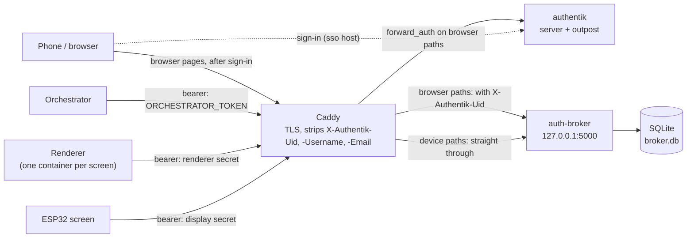
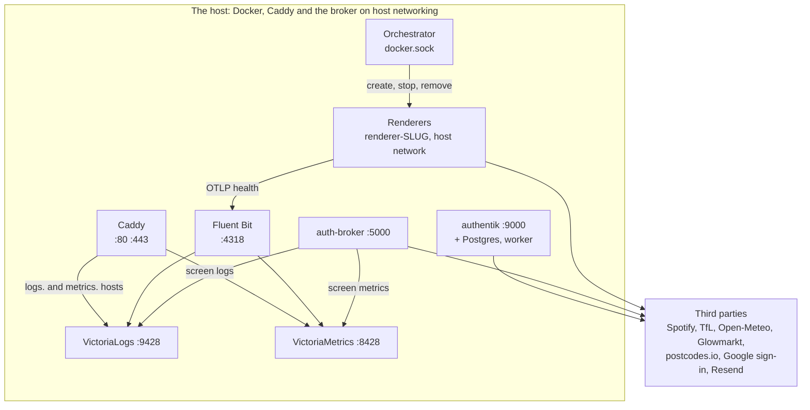
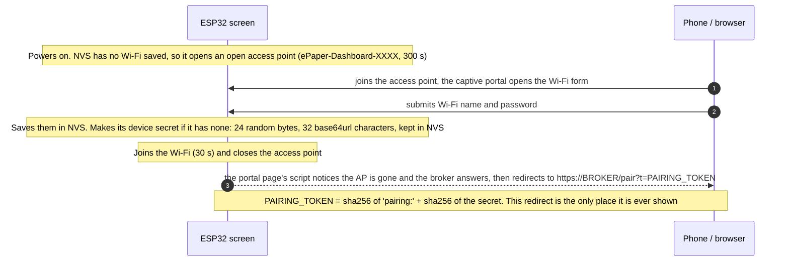
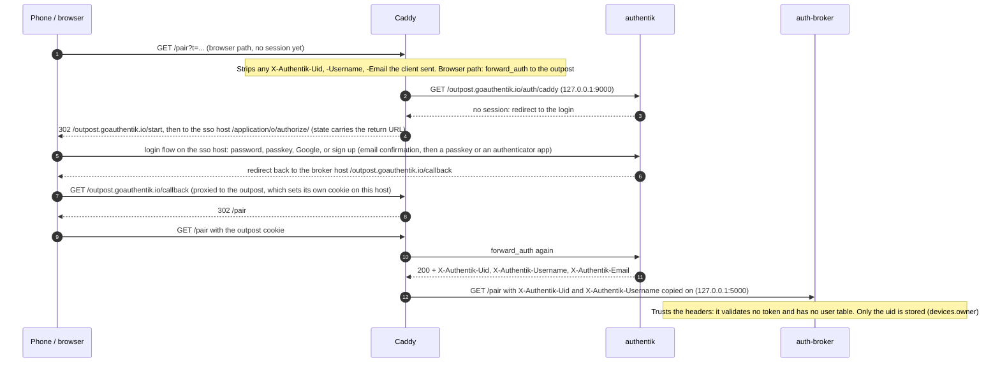
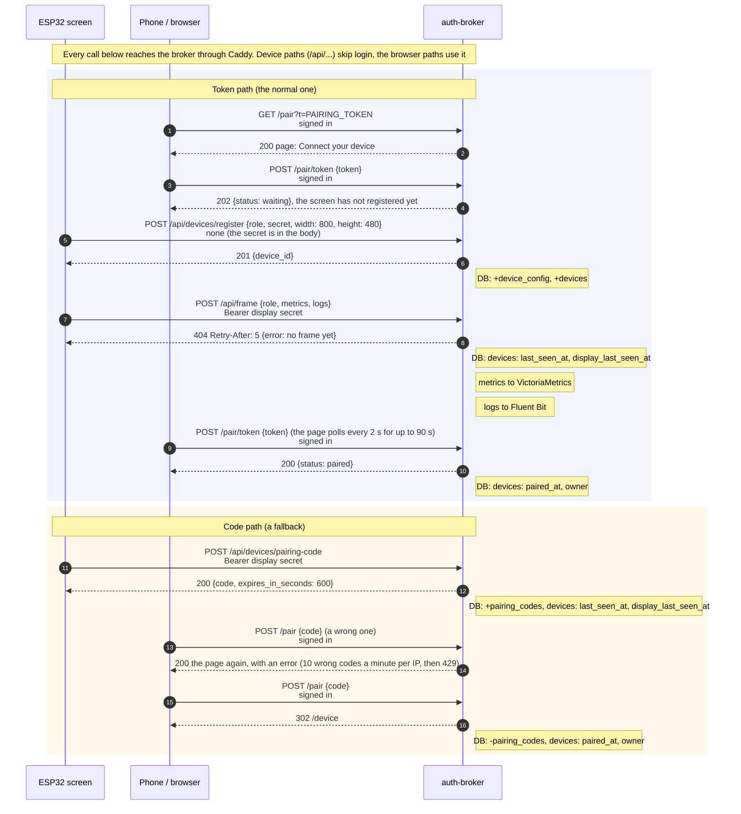
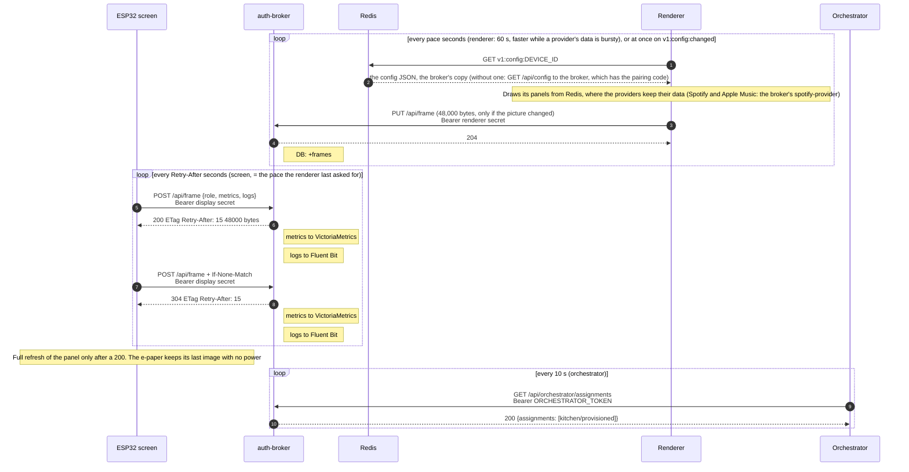
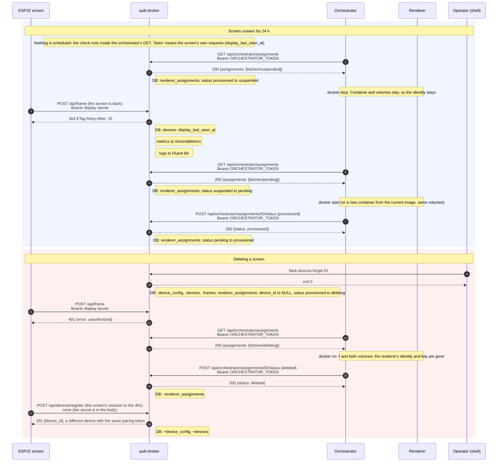
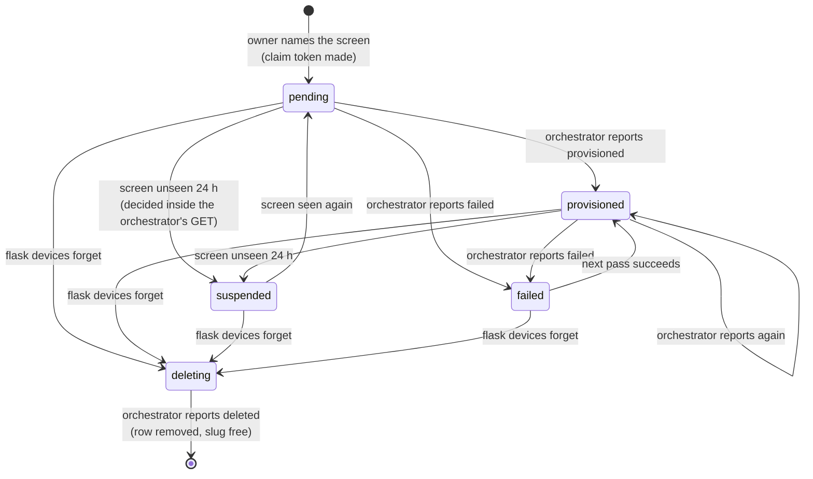

# How the pieces fit together

Who calls whom, which token exists when, and what each call changes. The README says how to run and deploy the broker;
this page is the map. [The database](database.md) has the tables.

- [The parts](#the-parts)
- [Who calls the broker, and how](#who-calls-the-broker-and-how)
- [Tokens and secrets: what exists when](#tokens-and-secrets-what-exists-when)
- [What happens when](#what-happens-when): [first boot](#1-first-boot-the-esp32), [signing in](#2-signing-in), [pairing](#3-pairing), [naming and provisioning](#4-naming-and-provisioning), [steady state](#5-steady-state), [suspension and deletion](#6-suspension-and-deletion)
- [Responses worth knowing](#responses-worth-knowing)
- [How this was checked](#how-this-was-checked)

## The parts

| Part | Where it lives | What it does |
|---|---|---|
| **ESP32 screen** | [countdown-esp32](https://github.com/nvorkinn/countdown-esp32), on the wall | Drives a Waveshare 7.5" e-paper panel (800x480, black and white). Registers with the broker, then polls it for finished frames and paints them. It draws nothing itself. |
| **Renderer** | [pi-dashboard](https://github.com/nvorkinn/pi-dashboard) (`countdown-server` image), one container per screen | Reads the screen's config from Redis (the broker's copy, see [the config in the store](#the-config-in-the-store)), or from the broker without one, and its panels' data from Redis, draws the 1-bit frame, uploads it. |
| **Orchestrator** | pi-dashboard (`countdown-orchestrator`), one container, mounts `docker.sock` | Polls the broker for *assignments* and starts, stops and removes the renderer containers to match. |
| **auth-broker** | this repository, gunicorn on `127.0.0.1:5000` | The hub: device identities, pairing, each screen's settings and its Spotify and Apple Music links, the latest frame, renderer assignments. State is one SQLite file. |
| **Caddy** | this repository (`caddy/`), the host's ports 80 and 443 | TLS, routing, the sign-in gate for browser pages, and the `X-Authentik-*` headers. |
| **authentik** | this repository (`terraform/`), behind the `sso.` host | Sign-in, sign-up, passkeys and authenticator apps, Google login. Its embedded outpost answers Caddy's forward_auth. |
| **Fluent Bit, VictoriaLogs, VictoriaMetrics** | this repository | Where the screens' and renderers' logs and metrics end up. |
| **Redis** | this repository, `127.0.0.1:6379` | The store between one provider per API (writing the latest data per stop or location) and the renderers (reading it). The broker writes the subscriptions and a copy of each screen's config; the glow-provider below is the first provider here. A cache only: nothing on disk. |
| **glow-provider** | this repository (`broker/providers/glow.py`), the broker's image, deployed with the broker | Reads the devices' Glowmarkt accounts from the database (read-only), fetches their readings from Glowmarkt and writes them to Redis (`v1:energy:<device id>`), so the passwords never leave the broker. See [the energy provider](../README.md#the-energy-provider). |
| **spotify-provider** | this repository (`broker/spotify_provider.py`), the broker's image with another command | Fetches each screen's Spotify and Apple Music with the broker's own tokens and code, and writes them to Redis for the renderers, with the playing tracks' covers (one copy per image, so the renderers never call the image hosts; see "Music in the store" in the README). Deployed with the broker. |
| **developer-provider** | this repository (`broker/developer_provider.py`), the broker's image with another command | Reads the devices and their GitHub tokens from the database (read-only, like the glow-provider). Polls each screen's GitHub and AI plans for as long as its developer panel is on, writes them to Redis for the renderers, and asks for a faster screen refresh (`v1:pace:developer:<device id>`) while a release runs. Deployed with the broker. See [Pace](#pace). |
| **countdown-api** | [countdown-api](https://github.com/nvorkinn/countdown-api), the `vendor/countdown-api` submodule | The OpenAPI contract between renderer and broker (so far `GET /api/config`) and the code generated from it. |

## Who calls the broker, and how



Caddy decides by path. The device paths (`/api/config`, `/api/frame`, `/api/devices/*`, `/api/renderers/*`,
`/api/status/*`, `/api/orchestrator/*`) go straight through: the broker checks the bearer secret
itself. Every other path is a browser page and needs an authentik sign-in first. Caddy deletes the `X-Authentik-Uid`,
`-Username` and `-Email` headers from every request, then, on browser paths only, copies on the ones the outpost returns. The broker **trusts**
`X-Authentik-Uid` and `-Username`: it validates no token and keeps no user table (only the uid, in `devices.owner`).
That is safe only because the broker listens on `127.0.0.1` and Caddy is the only way to it.



Everything runs on one host. Caddy, the broker, Fluent Bit, the two Victoria services and Redis use host networking,
authentik and its Postgres sit on the compose network with only `127.0.0.1:9000` published, and the orchestrator makes each renderer with
`network_mode: host`, so a renderer reaches the host's Fluent Bit on `127.0.0.1:4318` but talks to the broker over its
public URL (`BROKER_URL`).

| Caller | Calls | Authenticates with |
|---|---|---|
| **ESP32 screen** | `POST /api/devices/register` (5 a minute per IP, then 429), `POST /api/frame` (the same answer as `GET`, plus a metrics and logs report), `POST /api/devices/pairing-code` | nothing for register (the secret is in the body), otherwise the **display secret** |
| **Renderer** | `POST /api/renderers/claim`, `GET /api/config` (only when Redis has no copy of its config), `PUT /api/frame`, `POST /api/devices/pairing-code` | the **claim token** (claim only), otherwise the **renderer secret** |
| **Orchestrator** | `GET /api/orchestrator/assignments`, `POST /api/orchestrator/assignments/{id}/status` | `ORCHESTRATOR_TOKEN` |
| **Home Assistant** | `GET /api/status/devices` | `STATUS_TOKEN` |
| **Signed-in user** | `/pair`, `POST /pair/token`, `/device[/{id}]` and `/name`, `POST /api/displays/{id}/renderer`, Spotify connect and disconnect, `POST /device[/{id}]/display/unlink`, `GET /api/stops/search` (and its old name, `/api/tfl/search`), `GET /api/places/search` | `X-Authentik-Uid` from Caddy |
| **Operator** | `flask devices list \| code \| owner \| unpair \| forget` | a shell on the host |

[Which role may call what](../README.md#which-role-may-call-what) has the per-route role table. A wrong or missing
secret is a 401, a valid secret for the wrong role a 403.

## Tokens and secrets: what exists when

Several different things get called a token or a secret here, and they are not interchangeable. This is the whole list.

| Name | Made by, and when | Stored | Sent as | Ends when |
|---|---|---|---|---|
| **Display secret** | The ESP32, on first boot at the Wi-Fi portal: 24 random bytes, 32 base64url characters. Replaced if the broker answers 409 | ESP32: flash (NVS), plaintext. Broker: SHA-256, unsalted, in `devices.display_secret_hash` | `Authorization: Bearer …`; in the body of `POST /api/devices/register` | the owner presses "Unlink screen", `flask devices forget`, or the ESP32's flash is erased. No expiry, no rotation |
| **Renderer secret** | The renderer, on its first start: 24 random bytes | Renderer: `/data/.auth_broker_device`, Fernet-encrypted with a key in `/keys` (volumes `renderer-SLUG-data` and `-key`). Broker: `devices.renderer_secret_hash` | Bearer; in the body of the claim | the device is forgotten (the orchestrator then deletes the volumes). No expiry, no rotation |
| **Claim token** | The broker, when the owner names the screen: `token_urlsafe(32)` | Broker: `renderer_assignments.claim_token`, **plaintext**, because the orchestrator needs it back. Container: env `CLAIM_TOKEN` | the orchestrator reads it from the assignments list; the renderer sends it in the body of `POST /api/renderers/claim` | spent by the first claim (the column becomes NULL), or the device is forgotten. After that the orchestrator gives a recreated container the placeholder `already-claimed` |
| **Pairing token** | Both sides compute it: `sha256("pairing:" + sha256hex(display secret))` | Broker: `devices.pairing_token`, plaintext, set when the screen registers | in the URL the phone is redirected to (`/pair?t=…`), then in the body of `POST /pair/token` | the device is deleted. Pairing, unlinking and re-pairing never clear it |
| **Pairing code** | The broker, on request: `POST /api/devices/pairing-code`, `flask devices code`, or a renderer's `GET /api/config` while its device is unpaired. 6 characters | `pairing_codes.code`, plaintext | typed by the user at `/pair` | 10 minutes, one use, or a newer code for the same device |
| **Orchestrator token** | The operator: `ORCHESTRATOR_TOKEN` in `secrets/broker.env` (SOPS), and a GitHub secret in pi-dashboard for its deploy | environment variable on both sides | Bearer on `/api/orchestrator/*` | the operator changes it. Unset, those routes answer 404 |
| **Status token** | The operator: `STATUS_TOKEN` | environment | Bearer on `GET /api/status/devices` | changed by the operator. Unset: 404 |
| **`X-Authentik-Uid`, `-Username`** | authentik's outpost, copied onto the request by Caddy | not stored, except the uid in `devices.owner` | request headers, Caddy to broker, browser paths only | every request. Caddy removes any the client sent |
| **Outpost cookie** | The outpost, after sign-in, on the broker's host | the browser | cookie, browser to Caddy | authentik's session settings (its defaults: none are set in this repository) |
| **Flask session cookie** | The broker, only while someone connects Spotify | the browser, signed with `FLASK_SECRET_KEY`, not encrypted | cookie | the browser session. Holds the Spotify `state` and the target device id, nothing else |
| **Spotify tokens, per device** | Spotify, via `/auth/spotify/callback` | `spotify_tokens`, **plaintext** | never leave the broker | refreshed lazily when they expire. Deleted by Disconnect, `unpair --config` and `forget` |
| **Third-party keys** | The operator: `SPOTIFY_CLIENT_ID` and `_SECRET`, `TFL_APP_KEY` | environment | Spotify's as HTTP Basic to Spotify. There's no weather key: Open-Meteo needs none. `TFL_APP_KEY` never leaves the broker: it's only for TfL's stop lookups (the settings page's stop search and saved stops' names); pi-dashboard's TfL providers have their own, from its deploy's `TFL_APP_KEY` secret | the operator rotates them |
| **Glowmarkt credentials** | The owner, on `/device` | `glowmarkt_credentials`: the username as is, the password Fernet-encrypted with `CREDENTIAL_ENCRYPTION_KEY` | never sent: `GET /api/config` carries only `glowmarkt.enabled`; the glow-provider decrypts them, to sign in itself, and writes only the readings to Redis | cleared by `unpair --config` and `forget`. Changing the key makes stored passwords unreadable |
| **GitHub token, per device** | The owner, on `/device`: a fine-grained, read-only personal access token | `github_tokens`, Fernet-encrypted with `CREDENTIAL_ENCRYPTION_KEY` | never leaves the broker: the developer-provider makes the GitHub calls with it and writes only the panel's data to Redis | deleted by "Remove token", `unpair --config` and `forget`. GitHub expires it as the owner chose |
| **MusicKit key** | The operator: `APPLE_MUSIC_TEAM_ID`, `APPLE_MUSIC_KEY_ID` and `APPLE_MUSIC_PRIVATE_KEY` (the .p8), from an Apple Developer Program account | environment | never leaves the broker: it signs 12-hour developer tokens, which go to Apple and to the config page for MusicKit JS | the operator revokes and replaces it in Apple's developer portal. Unset: no Apple Music |
| **Apple Music user token, per device** | Apple, via MusicKit JS on `/device`, posted to `/device/<id>/apple-music/connect` | `apple_music_tokens`, Fernet-encrypted with `CREDENTIAL_ENCRYPTION_KEY` | never leaves the broker: the spotify-provider makes the Apple calls with it and writes only what was played to Redis | about six months, and can't be refreshed: cleared when Apple refuses it, so the page asks to connect again. Deleted with its play log by Disconnect, `unpair --config` and `forget` |
| **`LOGS_INGEST_TOKEN`** | The operator | Caddy's environment | Bearer on the `logs.` and `metrics.` ingest paths | Caddy only. The broker forwards on loopback without one |

Not secrets, though they look like it: `device_id` and an assignment's `id` (both `token_hex(6)`), and the **slug**
(`<username>-<what you typed>`, at most 32 characters), which names the container and its two volumes and never changes.

Which of the secrets exist in each phase of a screen's life (● valid at the broker, ◐ held by one side only,
✕ spent or deleted, · not made yet):

| | Boot | Registered | Paired | Named | Running | Suspended | Deleted |
|---|:-:|:-:|:-:|:-:|:-:|:-:|:-:|
| Display secret | ◐ | ● | ● | ● | ● | ● | ◐ (the screen's next poll is a 401, then it registers again) |
| Pairing token | ◐ | ● | ● | ● | ● | ● | ✕ |
| Pairing code | | on request, 10 minutes | | | | | |
| Claim token | · | · | · | ● (pending) | ✕ (spent at the claim) | ✕ | ✕ |
| Renderer secret | · | · | · | · | ● | ● (container stopped, volume kept) | ✕ (volumes removed) |
| Orchestrator token | ● | ● | ● | ● | ● | ● | ● |

## What happens when

Every arrow with a method and a status was **recorded by running the broker** (see [how this was checked](#how-this-was-checked));
the grey notes are the broker's table changes. Arrows for the firmware, Caddy, authentik and Docker come from reading
their code and configuration. Every call below passes through Caddy.

### 1. First boot: the ESP32



- **The e-paper shows nothing but broker frames.** There is no setup screen, no QR code and no pairing screen: the
  pairing URL exists only in the redirect on the phone.
- The access point is open (no password) and lasts 300 s, then the ESP32 restarts and tries the saved network again.
- After boot the Wi-Fi is not re-checked: a vanished network means a failed poll every 60 s, forever. The only reset
  is erasing the flash (`pio run -t erase`), after which the screen is a new device with a new secret.
- The broker address is a compile-time setting (`BROKER_URL`), not something the user enters.
- Source: countdown-esp32 `src/wifi_setup.cpp`, `src/main.cpp`, `lib/broker_client`, at `db77441`. Not run here.
- pi-dashboard's older Python screen client (`countdown/client`) is not described: it registers without a size, so
  this broker answers it with a 400.

### 2. Signing in



- Only browser paths do this. The broker never sees a password and checks no token or authentik cookie: it reads the two headers and ignores the rest.
- New users sign up through authentik's `broker-enrollment` flow, which is offered only to a login that came from
  `/pair`, asks for an email confirmation, and requires a passkey or an authenticator app before the first login.
- Source: `caddy/Caddyfile`, `terraform/`. The outpost's redirects are authentik's standard
  proxy-outpost behaviour; the repository holds only the configuration, and CI plans it against the live server without a browser sign-in.

### 3. Pairing



- The screen registers **once per boot** (and again after a 401), not on every poll.
- The pairing page polls `POST /pair/token` every 2 s for up to 90 s: `202` until the screen has registered, then `200`.
  Pairing again as the same user is fine; another user's device is a `409`.
- The code path is a fallback the ESP32 firmware does not use (it never asks for a code). A code can also hand a
  device that already has an owner to a new one, since it proves the person is at the device.
- Registering creates the `devices` and `device_config` rows at once, so the owner can pair and name the screen
  before any renderer exists. At most 20 screens may sit unpaired, and one still unpaired after 24 h is deleted the next
  time any new secret registers.

### 4. Naming and provisioning

```mermaid
sequenceDiagram
    autonumber
    participant P as Phone / browser
    participant B as auth-broker
    participant O as Orchestrator
    participant R as Renderer
    P->>B: GET /device<br/>signed in
    B-->>P: 302 Location: /device/96b060a7a3ef/name page: Redirecting...
    P->>B: POST /device/ID/name {slug}<br/>signed in
    B-->>P: 302 Location: /device/96b060a7a3ef page: Redirecting...
    Note right of B: DB: +renderer_assignments
    Note over B: slug = username + '-' + what the user typed, at most 32 characters, unique across the whole broker. claim_token is random (32 bytes) and kept as it is
    O->>B: GET /api/orchestrator/assignments (every 10 s)<br/>Bearer ORCHESTRATOR_TOKEN
    B-->>O: 200 {assignments: [kitchen/pending + claim_token]}
    Note over O,R: docker run renderer-SLUG: image RENDERER_IMAGE, host network, env BROKER_URL, DEVICE_NAME=SLUG, CLAIM_TOKEN, volumes renderer-SLUG-data and -key
    O->>B: POST /api/orchestrator/assignments/ID/status {provisioned}<br/>Bearer ORCHESTRATOR_TOKEN
    B-->>O: 200 {status: provisioned}
    Note right of B: DB: renderer_assignments: status pending to provisioned
    O-->>R: container starts
    Note over R: Makes its own secret (24 random bytes), keeps it Fernet-encrypted in /data, key in /keys
    R->>B: POST /api/renderers/claim {secret, claim_token}<br/>claim token in the body
    B-->>R: 201 {device_id}
    Note right of B: DB: devices: renderer_secret_hash, device_name (the slug, if it had none), renderer_assignments: claim_token
    R->>B: POST /api/renderers/claim (every restart)<br/>claim token in the body
    B-->>R: 200 {device_id}, the token is ignored
    Note over R,B: Reads its config from Redis (v1:config:DEVICE_ID, written when the screen was paired); GET /api/config only without it
```

- A new screen's owner is sent to the naming page before anything else works. The slug is
  `<username up to 16 characters>-<what they typed>`, at most 32 characters, unique across the whole broker.
- The orchestrator asks every 10 s. The `docker run` is the orchestrator's own action; the broker only hears
  `provisioned` afterwards. Capacity (`MAX_RENDERERS`) can hold an assignment at `pending`.
- The claim matches the renderer to its screen immediately: there is no waiting room. A repeat claim with the same
  secret is a `200`, which is what lets a restarted or upgraded container carry on.
- Source for the container: pi-dashboard `countdown/orchestrator/src/countdown_orchestrator/runtime.py`.

### 5. Steady state



- The screen sleeps for the `Retry-After` the broker sends: 60 s, or what the renderer asked for (20-59 s) while a
  provider's data is bursty, or 20 s while there is no frame yet. See [Pace](#pace).
- The renderer uploads only when its picture changed. If the same frame is uploaded again, only `frames.rendered_at`
  moves, which says the renderer is alive.
- A renderer that writes the frame record also puts each new picture in Redis, `v1:frame:<device id>` (a hash of the
  frame, its ETag and when it was drawn, TTL a day), and the broker answers the poll from it when it's newer than
  the `frames` row or the same picture, reading only its ETag for a 304. Without one, or while it can't be read, the
  row. See the README's [Frames in the store](../README.md#frames-in-the-store).
- Metrics and logs the screen reports are forwarded in the background to VictoriaMetrics and VictoriaLogs, and never
  slow or fail the poll. The `{device_id}` placeholder in the metrics text is replaced by the broker.
- `last_seen_at` moves on any authenticated call, at most once a minute; `display_last_seen_at` only on the screen's
  own calls. That second one is what decides suspension.

### 6. Suspension and deletion





- **There is no scheduler in the broker.** Suspension, un-suspension, code clean-up and the purge of stale
  unpaired screens all happen inside requests, mostly the orchestrator's poll.
- A suspended renderer is only stopped, never deleted: its container and both volumes stay, so it is the same device
  when the screen returns. `failed` is the orchestrator's own report and is never suspended.
- `forget` removes the device and everything hung on it (settings, codes, Spotify tokens, Glowmarkt credentials, the
  frame) but keeps the assignment, with no device, so the orchestrator still learns that the renderer and its volumes
  are to go. The screen's next poll is a 401, so it registers again with the same secret and becomes a *new* device with
  the same pairing token; its owner has to pair it again.
- `flask devices unpair` clears the owner and codes but keeps the secrets and the assignment; with `--config` it also
  resets the settings, which puts the stored screen size back to the column default (480x800), not what the screen
  registered with.

## Responses worth knowing

"Run" means the status was recorded from the broker; "code" means read from the code only.

| Call | Answer | Meaning | Checked |
|---|---|---|---|
| `POST /api/devices/register`, same secret again | `200 {device_id}` | every boot after the first | run |
| `POST /api/devices/register` without `width` and `height` | `400` | the size is required | run |
| `GET /api/config` with a display secret | `403` | a valid secret for the wrong role | run |
| Any device call with an unknown or deleted secret | `401 {error: unauthorized}` | the ESP32 registers again | run |
| `GET` or `POST /api/frame` before the first frame | `404` with `Retry-After: 5` | the renderer is about to upload | run |
| `POST /api/frame` with the current `ETag` | `304` with `ETag` and `Retry-After` | nothing new | run |
| `POST /api/devices/pairing-code` with a display secret | `200 {code, expires_in_seconds: 600}` | either role may ask | run |
| `POST /pair/token`, screen not registered yet | `202 {status: waiting}` | try again | run |
| `POST /pair`, wrong code | `200`, the page with an error | 10 wrong codes a minute per IP, then `429` | run, code |
| `POST /api/renderers/claim` with a display secret | `409` | already registered as a screen | run |
| `POST /api/renderers/claim`, unknown or spent token | `403` | | run |
| `POST /api/renderers/claim`, same secret again | `200 {device_id}` | a restart | run |
| `/api/orchestrator/*` with no token or a wrong one | `401` | | run |
| `POST /api/orchestrator/assignments/{id}/status` `deleted` for an assignment not `deleting` | `409` | | code |
| `PUT /api/frame` not exactly 48,000 bytes | `400` | 800x480, 1 bit per pixel | code |
| `POST /api/devices/register` with a renderer's secret | `409` | | code |

## How this was checked

The status codes, headers and table changes on the arrows above come from driving this broker's own Flask app
through a screen's whole life with its test client and a throwaway SQLite file, and comparing every table before and
after each call. The run covered registering, pairing by token and by code, naming, the orchestrator's list and
reports, the claim and a repeat claim, config polls, frame upload and poll (`200`, `304`, `404`), suspension and
return (with the clock simulated by moving the stored timestamps back 25 h), `flask devices forget`, and
registering again.

What was not run, and is described from reading the source or configuration: the ESP32 firmware, Caddy, authentik
(including every redirect of a sign-in), the orchestrator, Docker, and the third-party APIs.

| Source | Revision |
|---|---|
| auth-broker (this repository) | `ee1262c` |
| pi-dashboard (renderer, orchestrator) | `e219f5e` |
| countdown-esp32 | `db77441` |
| countdown-api | `2a932bd` |

If the code changes, these pages do not: check a diagram against the code before trusting it.

## Pace

How often a screen refreshes isn't a setting; the providers decide. A provider whose data is bursty (the developer
provider, while a release runs) writes a pace key to the store with a short TTL. The renderer reads the fastest of its
panels' keys, sleeps that long between cycles, and sends it as `X-Refresh-Hint` (seconds) with each `PUT /api/frame`.
The broker keeps it on the frame row for 3 minutes (`frames.pace`, `pace_until`; `services/pace.py`) and answers the
screen's polls with it as `Retry-After`, kept between 20 s and the 60 s base. Every upload restates the hint, so a
frame without one ends it, and a renderer that stops asking or dies lapses back to 60 s on its own.

## The config in the store

SQLite is the source of truth for each screen's settings; Redis holds a copy of what `GET /api/config` answers each
renderer, so a renderer needn't reach the broker to draw, and a save reaches it at once
(`broker/services/config_store.py`, made by `services/renderer_config.py` as the route's answer is).

```mermaid
sequenceDiagram
    autonumber
    participant P as Phone / browser
    participant B as auth-broker
    participant D as Redis
    participant R as Renderer
    R->>D: SUBSCRIBE v1:config:changed (once, at start)
    P->>B: POST /device/ID (the settings page)<br/>signed in
    Note right of B: DB: device_config, glowmarkt_credentials, github_tokens
    B->>D: v1:sub:* (MULTI: DEL, SADD), PUBLISH v1:sub:changed
    B->>D: MGET v1:config:* , then MULTI: SET v1:config:ID (only those that changed), PUBLISH v1:config:changed ID
    B-->>P: 302 /device/ID
    D-->>R: message: ID (its own; other screens' ids are ignored)
    R->>D: GET v1:config:ID
    Note over R: Redraws with the new config, without waiting for its 60 s
```

- **What's stored.** `v1:config:<device id>` holds exactly `GET /api/config`'s JSON for the device, the contract's
  `ConfigResponse`, less what mustn't be in Redis, which every provider and renderer can read: `pairing_code` is
  null. No API key is in it, and no Glowmarkt, GitHub, Spotify or Apple Music credential.
  `tests/fixtures/config_store.json` pins the shape, and pi-dashboard's tests read the same file.
- **When.** The whole set is rebuilt from the database on every config save, as the broker starts (gunicorn's
  `post_worker_init`, in `gunicorn.conf.py`), by `flask weather backfill` and by `flask config publish`; one device's
  key when its pairing changes (`/pair`, `POST /pair/token`, `POST /api/devices/pairing-code`, `flask devices code`,
  `owner`, `unpair`, `forget`). Only keys whose value changed are written, and only their devices are nudged on
  `v1:config:changed` (payload: the device id), in the same transaction, after the write.
- **No key** for a device that isn't paired, has a live pairing code, or is gone: its renderer then asks
  `GET /api/config`, which gives (and, while unpaired, issues) the code. Redeeming the code writes the key back and
  nudges. A code that lapses unused leaves the renderer on `GET /api/config` (which then has no code) until the next
  rebuild: any config save, a restart, or `flask config publish`.
- **No TTL**, as it's rebuilt from the database. `maxmemory-policy volatile-lru` evicts only keys with a TTL, so these
  are never evicted, and they count against `maxmemory 128mb` for good: about 700 bytes of JSON each, about 1 KB with
  Redis's own overhead, so a thousand screens take about 1 MB.
- **When Redis can't be written** during a save, the save still succeeds, the broker logs "Couldn't write the
  screens' configs to Redis", and a renderer keeps reading the copy that was there (or asks the broker, with none)
  until the next rebuild; `flask config publish` puts it right. Redis restarting loses the keys (it keeps nothing on
  disk): the renderers ask the broker until it restarts, someone saves, or `flask config publish` runs.
- **Rolling back** to a broker from before this leaves the keys in Redis, unrefreshed, and the renderers would keep
  reading them. Delete them first, on the host:
  `docker exec redis sh -c 'REDISCLI_AUTH="$REDIS_PASSWORD" redis-cli -h 127.0.0.1 --scan --pattern "v1:config:*" | xargs -r redis-cli -h 127.0.0.1 DEL'`
  (inside the same `sh -c`, so `REDISCLI_AUTH` applies to both).
- **device_name.** A renderer used to report it (its `DEVICE_NAME`, the slug) as `X-Device-Name` on every config poll.
  One reading the store may never poll, so the claim now names the device after its assignment's slug, if it has no
  name; a poll that sends the header still renames it.
