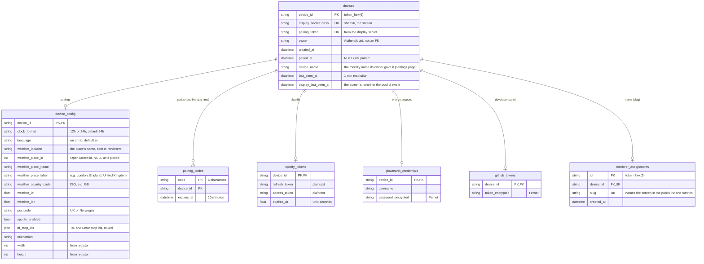

# The database

One SQLite file, `data/broker.db` (`/app/data/broker.db` in the container), owned by the broker. Alembic migrations
(`broker/migrations/`) run under a file lock every time the app starts, and
`tests/test_db.py::test_migrations_match_the_models` fails if they drift from `broker/models.py`. Timestamps are UTC.
[How the pieces fit together](architecture.md) shows when each row is written.

The screens' frames aren't here: pi-dashboard's render pool writes each to Redis (`v1:frame:<device id>`), and the
broker serves it from there (migration 0023 dropped the `frames` table, with the renderers' secrets and the claim
tokens).

Things the diagram can't say:

- Every table hangs off `devices`, by `device_id`. There is **no `ON DELETE` clause**: deleting a device cascades in the
  ORM (`flask devices forget` deletes the row and the ORM removes its `device_config`, `pairing_codes`, `spotify_tokens`,
  `glowmarkt_credentials`, `github_tokens` and `renderer_assignments`), and SQLite enforces the foreign keys
  (`PRAGMA foreign_keys=ON`).
- **`renderer_assignments` is a screen's name.** It's called that because it began as the renderer the orchestrator
  was to start for the screen; with the per-screen renderers gone, only the slug is left. The slug is unique across
  the whole broker and never changes. (`device_id` is still nullable, as it was when a forgotten device's assignment
  waited for the orchestrator; no row has a NULL one now.)
- **`devices.owner` is a plain string**, the authentik user id from `X-Authentik-Uid`. There is no users table and no
  foreign key. `paired_at` says whether the device has been paired.
- A device has **one secret**, the screen's (`display_secret_hash`), which identifies it on its own.
- `pairing_token` is derived from the display secret, so a screen that registers again after being forgotten gets the same
  token on its new row.
- Secrets are stored as SHA-256 hex, unsalted, which is enough because they are long random strings. **Stored in the
  clear:** `devices.pairing_token`, `pairing_codes.code` and the Spotify tokens. The Glowmarkt password, the GitHub
  token and the Apple Music token are encrypted (Fernet).
- `device_config.width` and `height` are what the screen reported when it registered. Their column defaults (480x800) apply to
  rows from before screens reported a size, and to `flask devices unpair --config`, which replaces the row.
- `device_config.clock_format` applies to all user-facing clock times on that screen, independently of its owner or
  their other screens. New and migrated rows default to `24h`; `12h` is the other supported choice. Ordinary unpairing
  and ownership transfer keep it, while `flask devices unpair --config` resets it to `24h`.

## Tables

| Table | One row per | Written by | Read by |
|---|---|---|---|
| `devices` | screen | `POST /api/devices/register` (insert, and deletes unpaired screens older than 24 h), pairing (`owner`, `paired_at`), the settings page (`device_name`, the friendly name), every device call (`last_seen_at`, `display_last_seen_at`), "Unlink screen", the CLI | every device call (secret lookup), the pages, the store's rewrites, `GET /api/status/devices`, the CLI |
| `device_config` | device | created at registration (with the screen's size), `POST /device` (settings), `unpair --config` | the store's copy of the config (`v1:config:`), `Retry-After` on frame polls, the providers, `/device` |
| `pairing_codes` | live code | `flask devices code` and `unpair`; deleted on use, on expiry (swept on each new code), by pairing and by `unpair` | `POST /pair`, the store's rewrites (a live code keeps a screen in the pool's list) |
| `spotify_tokens` | device that connected Spotify | `/auth/spotify/callback`, lazy refresh in the music provider | the music provider; deleted by Disconnect, `unpair --config`, `forget` |
| `glowmarkt_credentials` | device | `POST /device` | the config's `glowmarkt.enabled`, the glow-provider, `/device` |
| `github_tokens` | device given a GitHub token | `POST /device`; deleted by "Remove token", `unpair --config`, `forget` | the developer-provider, `/device` |
| `renderer_assignments` | named screen | pairing (insert: the slug is its device id), or its settings page for a screen paired before that; deleted with its device by `forget` | the pool's list of screens (`v1:render:screens`), the pages |

## What each action changes

| Action | Rows |
|---|---|
| Screen registers | insert `devices` (`display_secret_hash`, `pairing_token`), insert `device_config` (the size it reported) |
| Screen's first poll, before any frame | `devices.last_seen_at` and `display_last_seen_at` set |
| Owner's browser pairs by token | `devices.owner` = the authentik uid, `paired_at` set |
| Owner names the screen | insert `renderer_assignments` (the slug) |
| Screen polls again | `devices.last_seen_at` and `display_last_seen_at`, at most once a minute |
| `flask devices forget` | delete `devices`, `device_config` and `renderer_assignments` (and `pairing_codes`, `spotify_tokens`, `glowmarkt_credentials`, `github_tokens` if it had them) |
| `flask devices code` | insert `pairing_codes` |
| The code is typed at /pair | delete `pairing_codes`, `devices.owner` and `paired_at` set |
| `flask devices unpair` | `devices.owner` and `paired_at` to NULL, its codes deleted, a new code inserted |
| Owner presses Unlink screen | `devices.display_secret_hash` to NULL |

## The policies

The broker has one periodic job, and everything else happens as a side effect of a request:

| Policy | Runs in | Rule |
|---|---|---|
| The store's rewrite | a thread in each gunicorn worker, every minute (`config_store.start_resync`), and every config save, pairing change and naming | the configs (`v1:config:`) and the pool's list (`v1:render:screens`) are made to match the database, writing only what differs |
| Quiet screens | the store's rewrite | a screen is left out of the pool's list while the latest of `display_last_seen_at`, the device's `created_at` and the assignment's `created_at` is 24 h old; it's listed again at the first rewrite after it's seen |
| Stale unpaired screens | `POST /api/devices/register`, when a *new* secret registers | unpaired, unnamed and older than 24 h: deleted. At most 20 unpaired screens may exist; the 21st gets `503` |
| Expired codes | every new pairing code | all expired codes are deleted |
| Last seen | every device call | `last_seen_at` is written at most once a minute; `display_last_seen_at` likewise |
| Migrations | app start | applied under a file lock |
| Rate limits | `/pair` and `/api/devices/register` | in memory, per client IP: 10 wrong codes a minute, 5 registrations a minute, then a lockout that doubles from a minute up to an hour. They reset when the process restarts, and assume the broker's single gunicorn worker |
