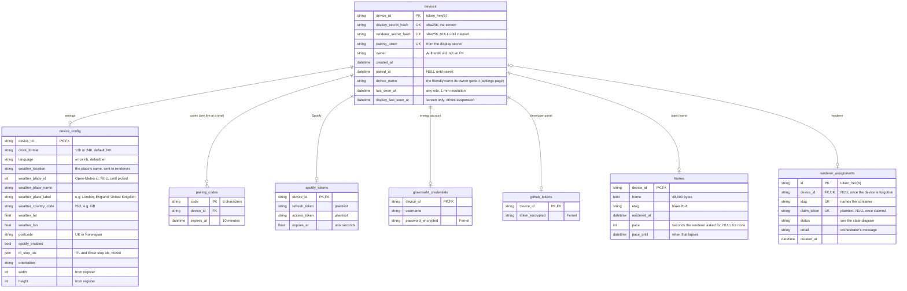

# The database

One SQLite file, `data/broker.db` (`/app/data/broker.db` in the container), owned by the broker. Alembic migrations
(`broker/migrations/`) run under a file lock every time the app starts, and
`tests/test_db.py::test_migrations_match_the_models` fails if they drift from `broker/models.py`. Timestamps are UTC.
[How the pieces fit together](architecture.md) shows when each row is written.

Things the diagram can't say:

- Every table hangs off `devices`, by `device_id`. There is **no `ON DELETE` clause**: deleting a device cascades in the
  ORM (`flask devices forget` deletes the row and the ORM removes its `device_config`, `pairing_codes`, `spotify_tokens`,
  `glowmarkt_credentials`, `github_tokens` and `frames`), and SQLite enforces the foreign keys (`PRAGMA foreign_keys=ON`).
- **`renderer_assignments` is the exception.** Its `device_id` is nullable and unique: a forgotten device leaves its
  assignment behind, with no device and status `deleting`, until the orchestrator confirms the container and volumes are
  gone. The assignment's `slug` is unique across the whole broker and is what names the container, so it never changes.
- **`devices.owner` is a plain string**, the authentik user id from `X-Authentik-Uid`. There is no users table and no
  foreign key. `paired_at` says whether the device has been paired.
- A device has **two secrets** (`display_secret_hash` for the screen, `renderer_secret_hash` for its renderer), each
  unique, each identifying the device on its own; the one that matches decides the caller's role. `renderer_secret_hash`
  stays NULL until the renderer claims.
- `pairing_token` is derived from the display secret, so a screen that registers again after being forgotten gets the same
  token on its new row.
- `frames` holds only the latest frame per device (an upsert), 48,000 bytes: 800x480, one bit per pixel.
- Secrets are stored as SHA-256 hex, unsalted, which is enough because they are long random strings. **Stored in the
  clear:** `renderer_assignments.claim_token`, `devices.pairing_token`, `pairing_codes.code` and the Spotify tokens.
  Only the Glowmarkt password is encrypted (Fernet).
- `device_config.width` and `height` are what the screen reported when it registered. Their column defaults (480x800) apply to
  rows from before screens reported a size, and to `flask devices unpair --config`, which replaces the row.
- `device_config.clock_format` applies to all user-facing clock times on that screen, independently of its owner or
  their other screens. New and migrated rows default to `24h`; `12h` is the other supported choice. Ordinary unpairing
  and ownership transfer keep it, while `flask devices unpair --config` resets it to `24h`.

## Tables

| Table | One row per | Written by | Read by |
|---|---|---|---|
| `devices` | screen and its renderer | `POST /api/devices/register` (insert, and deletes unpaired screens older than 24 h), `POST /api/renderers/claim` (`renderer_secret_hash`), pairing (`owner`, `paired_at`), the settings page (`device_name`, the friendly name), every device call (`last_seen_at`, and `display_last_seen_at` for the screen), "Unlink screen", the CLI | every device call (secret lookup), the pages, `GET /api/status/devices`, the CLI |
| `device_config` | device | created at registration (with the screen's size), `POST /device` (settings), `unpair --config` | `GET /api/config`, `Retry-After` on frame polls, the music provider, `/device` |
| `pairing_codes` | live code | `POST /api/devices/pairing-code`, `flask devices code`, `GET /api/config` while unpaired; deleted on use, on expiry (swept on each new code) and by `unpair` | `POST /pair`, `GET /api/config` |
| `spotify_tokens` | device that connected Spotify | `/auth/spotify/callback`, lazy refresh in the music provider | the music provider; deleted by Disconnect, `unpair --config`, `forget` |
| `glowmarkt_credentials` | device | `POST /device` | `GET /api/config`, `/device` |
| `github_tokens` | device given a GitHub token | `POST /device`; deleted by "Remove token", `unpair --config`, `forget` | the developer-provider, `/device` |
| `frames` | device | `PUT /api/frame` | `GET` and `POST /api/frame` |
| `renderer_assignments` | named screen | pairing (insert: the slug is the device id), the settings page for a screen paired before that, `POST /api/displays/{id}/renderer` (insert), `POST /api/renderers/claim` (`claim_token` to NULL), the orchestrator's list (**suspension and un-suspension happen here**), its status reports, `forget` (`deleting`) | the orchestrator's list, the pages |

## What each action changes

These rows were recorded by running the broker, one action at a time (secrets and tokens shortened).

| Action | Rows |
|---|---|
| Screen registers (A3) | insert `devices` (`display_secret_hash`, `pairing_token`), insert `device_config` (the size it reported) |
| Screen's first poll, before any frame (A4) | `devices.last_seen_at` and `display_last_seen_at` set |
| Owner's browser pairs by token (A5) | `devices.owner` = the authentik uid, `paired_at` set |
| Owner names the screen (A7) | insert `renderer_assignments` (`status` pending, `claim_token` set) |
| Orchestrator reports `provisioned` (A9) | `renderer_assignments.status` pending to provisioned |
| Renderer claims (A10) | `devices.renderer_secret_hash` set, `renderer_assignments.claim_token` to NULL |
| Renderer's config poll (A11) | `devices.device_name` = `X-Device-Name` (the first time it changes) |
| Renderer's first frame (A12) | insert `frames` |
| The same frame again (B3) | `frames.rendered_at` |
| Orchestrator polls, screen unseen 24 h (C1) | `renderer_assignments.status` provisioned to suspended |
| Screen polls again (C2) | `devices.display_last_seen_at` |
| Orchestrator polls, screen seen (C3) | `renderer_assignments.status` suspended to pending |
| `flask devices forget` (D1) | delete `devices`, `device_config` and `frames` (and `pairing_codes`, `spotify_tokens`, `glowmarkt_credentials` if it had them), `renderer_assignments.device_id` to NULL and `status` to deleting |
| Orchestrator reports `deleted` (D5) | delete `renderer_assignments` |
| A pairing code is requested (E5) | insert `pairing_codes`, `devices.last_seen_at` and `display_last_seen_at` |
| The code is typed at /pair (E5c) | delete `pairing_codes`, `devices.owner` and `paired_at` set |
| Owner presses Unlink screen (E12) | `devices.display_secret_hash` to NULL |

## The policies that run inside requests

There is no scheduler or periodic job. Everything below happens as a side effect of a request:

| Policy | Runs in | Rule |
|---|---|---|
| Suspension | `GET /api/orchestrator/assignments` | a `pending` or `provisioned` assignment becomes `suspended` when the latest of `display_last_seen_at`, the device's `created_at` and the assignment's `created_at` is 24 h old; a `suspended` one becomes `pending` again as soon as it is not |
| Stale unpaired screens | `POST /api/devices/register`, when a *new* secret registers | unpaired, no renderer, no assignment and older than 24 h: deleted. At most 20 unpaired screens may exist; the 21st gets `503` |
| Expired codes | every new pairing code | all expired codes are deleted |
| Last seen | every device call | `last_seen_at` is written at most once a minute; `display_last_seen_at` likewise, for the screen's own calls |
| Migrations | app start | applied under a file lock |
| Rate limits | `/pair` and `/api/devices/register` | in memory, per client IP: 10 wrong codes a minute, 5 registrations a minute, then a lockout that doubles from a minute up to an hour. They reset when the process restarts, and assume the broker's single gunicorn worker |
