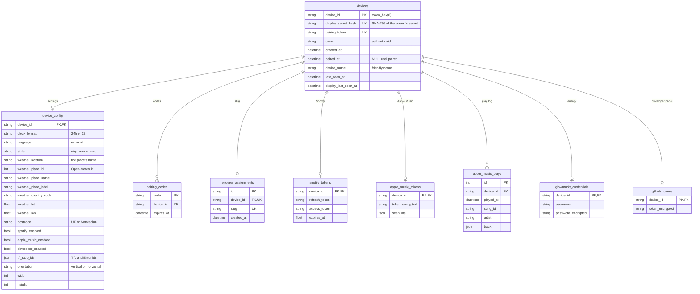

# The database

One SQLite file, `data/broker.db` (`/app/data/broker.db` in the container), owned by the broker. The schema is
`broker/models.py`; Alembic migrations (`broker/migrations/`) run under a file lock when the app starts. Timestamps are
UTC. Frames aren't here: the render pool keeps them in Redis.

| Table | One row per | Notes |
|---|---|---|
| `devices` | screen | Created when the screen registers. `owner` is a plain string (there's no users table). `last_seen_at` and `display_last_seen_at` are updated at most once a minute; the latter decides whether the pool still draws the screen. |
| `device_config` | screen | Created at registration with the size the screen reported. `tfl_stop_ids` holds TfL and Entur (`NSR:...`) stops in the owner's order. |
| `pairing_codes` | live code | 10 minutes, one use. Expired codes are swept whenever a new one is issued. |
| `renderer_assignments` | paired screen | The screen's slug (its device id), which names it in `v1:render:screens` and in metrics. It never changes. |
| `spotify_tokens` | linked Spotify account | Plaintext. Refreshed by the music provider. |
| `apple_music_tokens` | linked Apple Music account | The token is encrypted. `seen_ids` is how far the play log has got. |
| `apple_music_plays` | play seen | Apple Music has no top lists, so the music provider logs plays and counts them. |
| `glowmarkt_credentials` | linked Glowmarkt account | The password is encrypted. |
| `github_tokens` | developer panel token | Encrypted. |

- **Encryption.** The encrypted columns use Fernet with `CREDENTIAL_ENCRYPTION_KEY`. The screen secret is stored as an
  unsalted SHA-256, which is enough for a long random string. The pairing token, pairing codes and Spotify tokens are
  in the clear.
- **Deleting.** Every table hangs off `devices`. There's no `ON DELETE` in the schema: the ORM cascades, so
  `flask devices forget` removes the device and all its rows. SQLite enforces the foreign keys.
- **Resetting.** `flask devices unpair --config` replaces `device_config`, so its width and height go back to the column
  defaults (480x800), not the size the screen registered with. Registering again doesn't update them.
- **Read-only readers.** The glow and developer providers open the file with SQLite's `mode=ro` on a read-only mount.
  That works because the database uses the default rollback journal, not WAL (`tests/test_db.py` checks).
- **Rate limits** for `/pair` codes and `/api/devices/register` are in memory, per IP, and reset on restart. They
  assume a single gunicorn worker.
